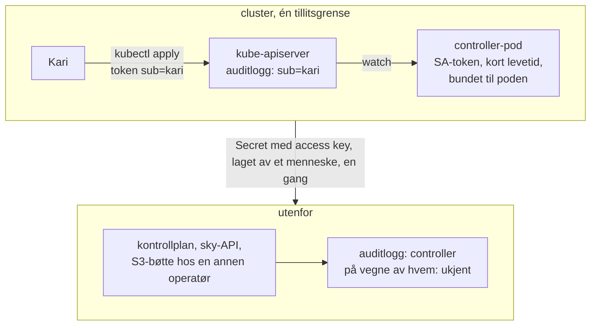
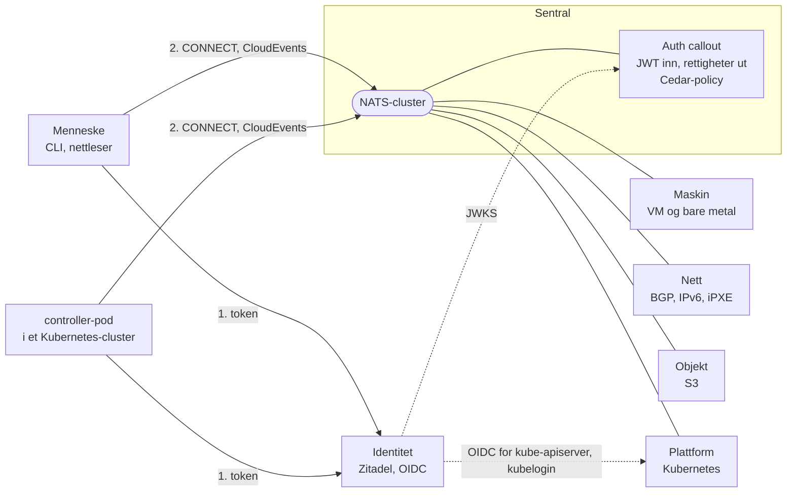
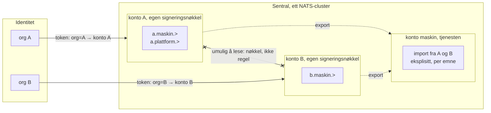
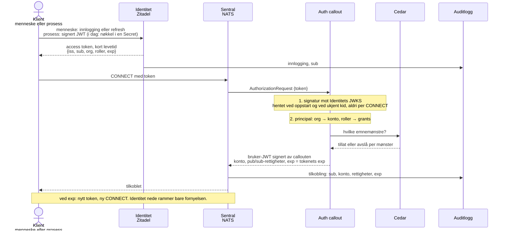
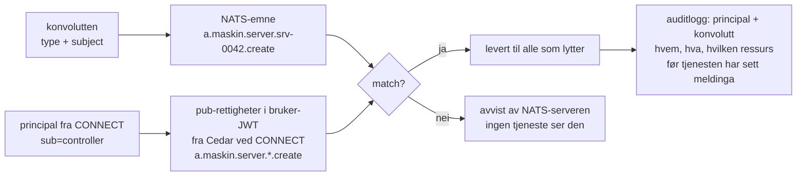
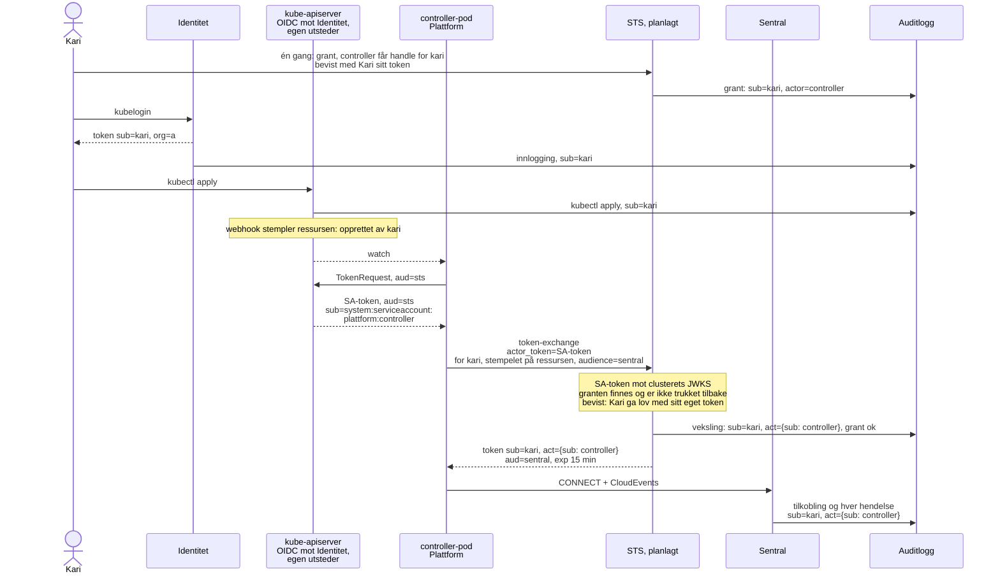
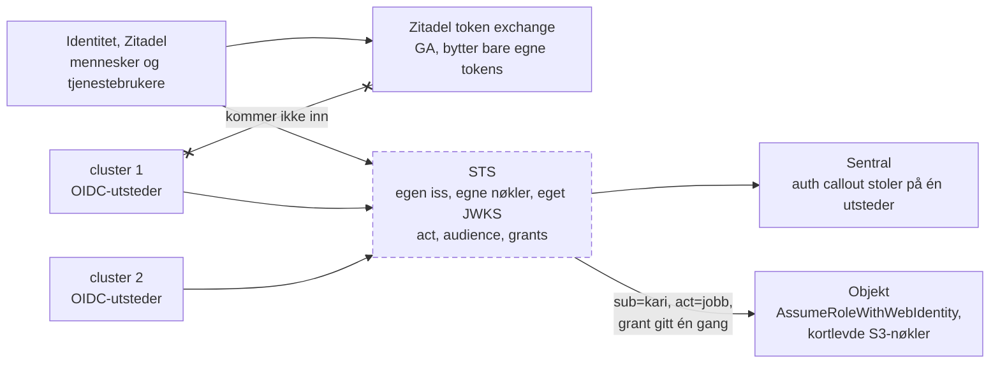

<!--
Skjelett. Tidsbudsjett, 45 minutter:
  0–5    Innledning, begge
  5–22   Kontrollplanet, Jan Ivar
  22–34  Salmon, Linus
  34–36  Ønskelisten, begge
  36–44  Spørsmål dem imellom: først tre om Salmon fra Jan Ivar, så tre om Dataverket fra Linus
  44–45  Publikum, eller avslutt
Skilleark har class skille, Q&A-bildene class sporsmal.
-->


# Maskiner som logger inn

Maskinidentitet, delegering og tillit med åpen kildekode

Containerkonferansen | Trondheim, 14. oktober 2026 | Jan Ivar Beddari og Linus Johansen

---

<!-- _class: skille -->

## Hvilken maskin er dette, og hvem kjører hva på den?

Innledning, 5 minutter, begge

---

## Hvorfor står vi her

<!--
Jan Ivar: UH-sky og Safespring var hendelsesdrevne kontrollplan med mennesker og maskiner på samme buss. I Dataverket er poder principals fra dag én, og de logger inn i dag med en nøkkel i en Secret.
Linus: identitetsplattformene er laget for mennesker. RFC 8693 er lest, men ikke ferdig implementert noe sted. Derfor salmon.
Vi fant hverandre fordi vi manglet det samme.
-->

- Jan Ivar: UH-sky / NREC, ti år i Safespring med hendelsesdrevne kontrollplan. I 2026: Dataverket, et åpent kontrollplan for suveren skyinfrastruktur
- Linus: salmon, en identitetsleverandør for mennesker og arbeidslaster, skrevet fordi de som finnes er bygget for mennesker
- Vi traff samme vegg fra hver vår side: en maskin som skal handle for et menneske, utenfor clusteret den bor i

---

## I dag: hvilken prosess på hvilken maskin er dette?

<!--
Et projisert ServiceAccount-token, slik det ser ut i dag. Alle i salen har tusenvis av dem.
- Kort levetid, bundet til poden, signert av clusterets egen OIDC-utsteder med discovery og JWKS.
- RBAC sjekker bare verb, ressurs og namespace. Loggen i kube-apiserver vet hvem som gjorde hva.
Første halvdel av spørsmålet er besvart, så langt clusteret rekker. Se etter mennesket i tokenet. Det er ikke der.
-->

```json
{
  "iss": "https://kubernetes.default.svc.cluster.local",
  "sub": "system:serviceaccount:plattform:controller",
  "aud": ["https://kubernetes.default.svc.cluster.local"],
  "exp": 1791979500,
  "kubernetes.io": {
    "namespace": "plattform",
    "serviceaccount": { "name": "controller", "uid": "…" },
    "pod": { "name": "controller-6c9d4-x7k2p", "uid": "…" },
    "node": { "name": "node-07", "uid": "…" }
  }
}
```

Prosess, maskin og organisasjon står i tokenet. Kort levetid, bundet til poden, signert av clusterets egen OIDC-utsteder. RBAC sjekker bare verb, ressurs og namespace.

Ingen claim sier hvilket menneske som har ansvaret.

---

## I dag: clusteret er grensen

<style scoped>img { max-height: 330px; }</style>

<!--
Kari gjør kubectl apply. Loggen i kube-apiserver sier kari. Controlleren ser endringen og skal gjøre noe utenfor: et kontrollplan, en sky-API, et annet cluster, en meldingsbuss.
Tilgangen ut av clusteret er i dag en statisk nøkkel i en Secret. Et menneske laget den én gang, og den lever til noen husker å bytte den. Slik er det i Dataverket også.
To tidsskalaer, samme hull. Interaktivt: Kari gjør noe nå, controlleren gjør det for henne. Over tid: en jobb som skriver til en S3-bøtte hos en annen operatør hver natt, med en access key noen laget i fjor. Begge må kunne spores til et menneske.
På den andre siden sier loggen «controller». Kari er borte.
De store skyleverandørene har løst dette for sine egne tjenester: IRSA hos AWS, Workload Identity Federation hos Google og Azure. Samme projiserte token, vekslet inn i en kortlevd nøkkel. Åpne identitetsløsninger er laget for mennesker og mangler tilsvarende. Zitadel veksler bare egne tokens, Keycloak er på vei.
-->



Enten Kari gjør det nå eller en jobb gjør det hver natt i et år: tilgangen ut av clusteret er en statisk nøkkel som ble laget én gang. De store skyleverandørene har løst dette for sine egne tjenester. Åpne identitetsløsninger mangler tilsvarende.

---

## Det haster å finne bedre løsninger!

<!--
Operatormønsteret er ti år gammelt, og vi har levd med at loggen sier «controller». En agent er noe annet: den velger selv hva den gjør, med nøkler noen ga den én gang.
Når maskinen bare gjør det koden sier, følger handlingen av noe et menneske skrev. Da går det an å finne mennesket i etterkant: ressursen i clusteret, git-historikken, hvem som godkjente. Tungvint, men mulig. Når maskinen velger selv, følger ikke handlingen av koden lenger, og samme agent handler for mange mennesker. Koden peker på den som satte agenten i gang, ikke på den som ba om akkurat denne handlingen. Det står ingen steder, med mindre det ble registrert idet det skjedde. Derfor må mennesket finnes i tokenet og logges når det skjer.
-->

- Operatorer, GitOps-controllere og CI-runnere har gjort jobben for oss i ti år. Vi har godtatt at loggen sier «controller»
- En agent velger selv hva den gjør, med nøkler noen ga den én gang
- Loggen sier *hva* som ble gjort og *hvilken maskin* som gjorde det. Den sier sjelden **hvilket menneske som sto bak**

Når maskinen bare gjør det koden sier, kan vi finne mennesket i etterkant, i koden og i ressursen. Når maskinen velger selv, må mennesket finnes i tokenet og logges når det skjer.

---

## Ett problem, to halvdeler

<!--
Dette er disposisjonen. Første halvdel har Dataverket svar på, og Jan Ivar viser hvordan: organisasjon blir konto, token blir tilkobling, konvolutten avgjør. Andre halvdel er hullet. Jan Ivar viser hvor det er, Linus viser det han har bygget for å fylle det. Til slutt ønskelisten.
-->

**Hvilken prosess på hvilken maskin er dette?**
Server, VM eller pod: hvilken organisasjon hører den til, og hvordan beviser den det uten en nøkkel? Det har vi svar på. Jan Ivar viser hvordan.

**Men HVEM kjører hva på den??!**
Mennesket med ansvar for maskina må følge med i tokenet, ut av clusteret og inn i loggen. Dette har ingen gode svar på i dag. Linus har begynt på relevant kode!

Til slutt: Vår ønskeliste til alle, så hver av oss slipper å bygge dette alene.

---

<!-- _class: skille -->

## Kontrollplanet

Hvilken prosess på hvilken maskin er dette? Jan Ivar, 17 minutter

---

## Dataverket på ett bilde

<!--
Premissene først, så bildet.
- Alle logger inn ett sted. Ingen lokale brukere, ingen langlevde nøkler.
- Alt som gjøres må logges, og loggen må peke på en identitet.
- Én organisasjon er ett sikkerhetsdomene, kryptografisk, ikke ved policy.
- Koden skal kunne kjøres og driftes uten oss.
Kravene er de samme som i NSM 2.1, 2.6, 2.7, CRA vedlegg I og DFØ B.IS.30–32. Vi bygger dem inn, ikke oppå.

Bildet: Go, AGPL v3. Meldinger over NATS, alle som CloudEvents. Identitet er Zitadel i dag.
To principals til venstre: et menneske og en controller-pod. Begge henter token fra Identitet, begge kobler til Sentral på samme måte. Plattform er Kubernetes, så dere er allerede i bildet.
kube-apiserver i Plattform bruker også Identitet, med kubelogin. Kari har samme sub i clusterets auditlogg som i Sentrals. Det er forutsetningen for delegeringsslidet.
Dette er status nå. Poden henter token fra Identitet med en nøkkel i en Secret. STS-en og Salmon kommer på de tre siste slidene i min del.
-->



---

## Én organisasjon er ett sikkerhetsdomene

<!--
Hvilken maskin er dette, første del: hvilken organisasjon. Kryss-trafikk skal være umulig ved nøkkel, ikke sperret av en regel.
- En NATS-konto har egen signeringsnøkkel. Et emne i konto A finnes ikke i konto B.
- Hver organisasjon i Identitet blir én konto for mennesker og maskiner.
- Hver tjeneste har sin egen konto, og importerer eksplisitt, emne for emne.
- Ingen policy å glemme, ingen regel som kan skrives feil.
I Kubernetes stopper NetworkPolicy trafikken. Her finnes det ingen trafikk å stoppe.
Kontoen er grensen. Auth callout bestemmer hvem som slipper inn i den, neste bilde.
-->



Kubernetes: namespace er en policy-grense. NATS: konto er en nøkkelgrense.

---

## Innslipp: tilkobling til kontrollplanet

<!--
Hvilken maskin er dette, andre del: hvordan beviser den det. Kortlevde tokens, ingen statiske credentials. Slått sammen fra de to BLUG-diagrammene.
Callouten gjør lite, med vilje:
- Verifiserer signaturen mot Identitets JWKS, hentet ved oppstart og ved ukjent kid. Aldri per CONNECT.
- Bygger principal fra claims: org gir konto, roller gir rettigheter.
- Spør Cedar: hvilke emnemønstre får denne principalen publisere og abonnere på?
- Svarer NATS med en signert bruker-JWT som utløper når tokenet utløper.
- Tilkoblingen logges: hvem, hvilken konto, hvilke rettigheter, hvor lenge. Loggen starter ved døra. De neste to slidene bygger på den.
Ingen kall til Identitet på den varme stien. Identitet nede rammer bare fornyelsen.
Mennesker har ingen hemmeligheter å rotere. Prosesser har det fortsatt: i dag en signert JWT med nøkkel i en Secret. Det er hullet, og vi kommer dit.
Cedar er policyspråket, samme som i Salmon.
-->



---

## En melding i Sentral

<!--
Dette er det som går over bussen. Kommandoer, hendelser, spørringer og svar har samme konvolutt. CloudEvents 1.0, CNCF, samme som Knative bruker.
- type sier hva. source sier hvilken prosess som sendte. subject sier hvilken ressurs det gjelder.
- Alle ressurser har en global ID som kan stå i en regel. Formatet følger ARN: tjeneste, region, org, type og ID. Illustrasjon, ikke vedtatt.
- data er tjenestens sak. Sentral leser den aldri, og trenger ikke forstå tjenesten for å beskytte den.
-->

```json
{
  "specversion": "1.0",
  "type": "maskin.server.create",
  "source": "dvk:plattform:r1:a:controller/maskin",
  "subject": "dvk:maskin:r1:a:server/srv-0042",
  "id": "…",
  "time": "2026-10-14T11:07:12Z",
  "data": { "cpu": 64, "minne": "512G", "nett": "…" }
}
```

Kommandoer, hendelser, spørringer og svar: samme konvolutt. CloudEvents 1.0, CNCF.

Sentral leser aldri `data`. Resten er nok til å rute, tillate og logge.

---

## Konvolutten bestemmer, ikke innholdet

<style scoped>img { max-height: 420px; }</style>

<!--
Samme melding som forrige slide.
- Emnet utledes av type og subject. Rettighetene er emnemønstre gitt ved CONNECT, så serveren matcher uten å lese noe annet.
- Avvises meldinga, er det NATS-serveren som avviser den, og ingen tjeneste ser den.
Auditloggen er principalen fra CONNECT pluss konvolutten: hvem, hva og hvilken ressurs. Den finnes før tjenesten har sett meldinga. I dag er «hvem» prosessen.
Når STS-en kommer, er det bare principal-boksen som endres. Neste slide.
Samme mønster som RBAC: den sjekker bare verb, ressurs og namespace, aldri spec.
-->

RBAC sjekker bare verb, ressurs og namespace. Sentral sjekker bare type, ressurs-ID og org.



---

## Løsning: delegering med RFC 8693

<!--
Ingenting i Sentral endres fra forrige slide. STS-en bytter bare ut principalen: sub=kari, act=controller. Match og auditlogg er de samme.
Azure Workload Identity og Google Workload Identity Federation gjør akkurat denne vekslingen, projisert SA-token inn, kortlevd token ut, mot sin egen STS. Vi gjør den mot vår. Salmon er bygget på Azure-modellen, Linus kommer tilbake til det.
På vegne av hvem: her begynner andre halvdel. Operatormønsteret fra innledningen: en controller handler på vegne av Kari, nå uten Secret.
- Granten gis én gang per workload, ikke per apply: controller i dette clusteret får handle for kari, i org A, til hun trekker det tilbake. Verktøyet hennes lager den første gang det snakker med clusteret, med Kari sitt eget token som bevis. Som en federated credential: opprettet én gang, brukt hver gang.
- Kari logger inn i clusteret med Identitet og gjør apply. kube-apiserver logger kari, og en webhook stempler ressursen med verifisert bruker. En validerende regel låser feltet. Stempelet beviser ingenting mot STS-en, det velger hvilken grant controlleren skal bruke for akkurat denne ressursen. Controlleren ser aldri Kari sitt token, og trenger det ikke.
- Granten er det samme som en federated credential i Azure eller en IAM-binding i Google: opprettet én gang av et menneske, så veksler workloaden uten at mennesket er der. Vi bygger det som workload identity. Forskjellen er at mennesket blir med i tokenet ut, slik AWS SourceIdentity følger en rollekjede.
- sub er mennesket. act er prosessen som handler for det. Kjeden kan nestes: controller for pipeline for Kari.
- may_act er granten: en rad i STS-en, ikke bare et claim. Hvem får handle for hvem, i hvilken org, til det trekkes tilbake. Cedar sjekker raden ved hver veksling. Beviset er granten pluss stempelet: Kari ga lov med sitt eget token, og kube-apiserver har verifisert at det var hun som opprettet ressursen.
- Samme grant dekker jobben som går hver natt mot en S3-bøtte hos Objekt. Neste slide.
- 15 minutters levetid. aud er mottakeren, ikke utstederen.
Poden trenger ingen Secret. TokenRequest gir et kortlevd SA-token med den audiencen vi ber om, og clusterets egen OIDC-utsteder signerer det.
Hver hendelse i Sentral kan spores til en person, også når en maskin sendte den.
STS er planlagt, ikke bygget. RFC 8693 §4.1 act, §4.4 may_act. Kubernetes: structured authentication config, projected ServiceAccount tokens, TokenRequest API, issuer discovery. Granten opprettes av et kubectl-plugin eller Dataverkets CLI, første gang. Stempelet settes av en mutating webhook og låses med ValidatingAdmissionPolicy eller Kyverno, slik Rancher gjør med field.cattle.io/creatorId.
-->



---

## Hullet

<style scoped>img { max-height: 380px; }</style>

<!--
Det vi trenger av en STS:
- Egen iss, egne signeringsnøkler, eget JWKS. Tjenester verifiserer mot én utsteder.
- Tar imot Zitadels tokens for mennesker og tjenestebrukere.
- Tar imot SA-tokens fra hvert clusters innebygde OIDC-utsteder.
- Utsteder sub, act, aud, org og roller, slik callouten vil ha dem.
- Lagrer grants: hvem får handle for hvem, i hvilket omfang, til det trekkes tilbake. may_act som rad, slik Salmon alt har tillit til en workload som én rad.
Zitadels token exchange er GA, men bytter bare Zitadels egne tokens. Keycloak og de andre er bygget for mennesker.
Objekt-tilfellet: jobben i clusteret veksler sitt SA-token hos STS-en mot et token med sub=kari og act=jobb, på samme slags grant som på forrige slide, gitt én gang og mulig å trekke tilbake. Objekt-gatewayen tar det tokenet i AssumeRoleWithWebIdentity og gir S3-nøkler som lever i timer, ikke år. Gatewayens egen logg navngir mennesket. Både versitygw og RadosGW gjør dette i dag, mot et token fra en utsteder de stoler på.
Dette må alle som trenger delegert maskinidentitet bygge selv i dag. Linus har begynt. Overgang.
-->

Den stiplede boksen finnes ikke i dag. Linus har begynt å skrive den. Samme token åpner en S3-bøtte hos Objekt, uten access key i en Secret.



---

<!-- _class: skille -->

## Salmon

Hvem kjører hva på den? Linus, 12 minutter

---

## Hva salmon er

---

## Datamodellen

---

## Token exchange, flyten

---

## Hva som mangler

---

<!-- _class: skille -->

## Ønskelisten

Begge, 2 minutter

---

## Til det norske åpen kildekode-fellesskapet

- Modne delegeringsprofiler i identitetsplattformene
- Standardisert identitet for meldinger
- Gjenbrukbare byggeklosser i et kontrollplan

---

<!-- _class: skille -->

## Spørsmål

Dem imellom, 8 minutter. Først tre om Salmon, så tre om Dataverket.

---

<!-- _class: sporsmal -->

## Om Salmon, 1

<!-- Jan Ivar spør, Linus svarer. -->

---

<!-- _class: sporsmal -->

## Om Salmon, 2

<!-- Jan Ivar spør, Linus svarer. -->

---

<!-- _class: sporsmal -->

## Om Salmon, 3

<!-- Jan Ivar spør, Linus svarer. Forslag: tillit til en workload er én rad i Salmon. Kan en grant være samme slags rad, menneske, workload, omfang, trukket tilbake når? Og hva må til for at et menneske kan være subjekt? -->

---

<!-- _class: sporsmal -->

## Om Dataverket, 1

<!-- Linus spør, Jan Ivar svarer. Forslag fra notatet: når Kari kommer inn via kubelogin, hvem er «brukeren» i Sentral, Zitadel-sub eller STS-sub? Og hva om samme menneske kommer fra en annen utsteder i morgen? -->

---

<!-- _class: sporsmal -->

## Om Dataverket, 2

<!-- Linus spør, Jan Ivar svarer. -->

---

<!-- _class: sporsmal -->

## Om Dataverket, 3

<!-- Linus spør, Jan Ivar svarer. -->

---

## Ett problem, to svar

**Hvilken prosess på hvilken maskin er dette?** En konto i Sentral som speiler organisasjonen, et token som utløper, en konvolutt som avgjør. Ingen hemmeligheter å rotere.

**Hvem kjører hva på den?** `sub` er mennesket som har ansvaret, `act` er prosessen som handler for det, utstedt av en STS på en grant mennesket selv ga, slik workload identity gjør det hos skyleverandørene. STS-en finnes ikke ferdig i dag. Linus har begynt å skrive den.

Bli med i Dataverket: medlem@dataverket.org

<!-- Publikum tar over herfra, eller vi avslutter. -->
